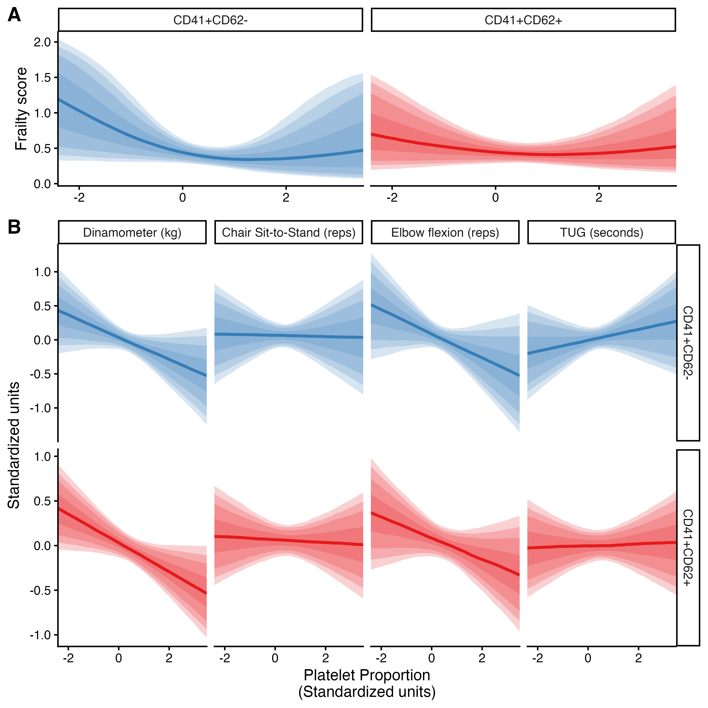
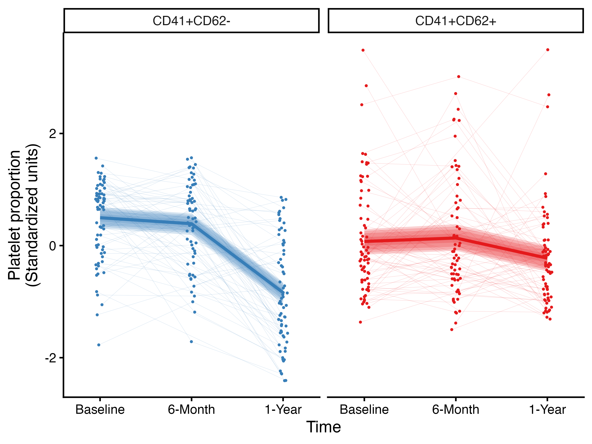

---
# Manuscript (revised version, response to the second-round peer review).
# Render with:  quarto render manuscript/manuscript.qmd
# The line numbering, page setup and fonts come from reference-manuscript.docx
# (styles of manuscript/submission/manuscript_clean_version.docx).
format:
  docx:
    reference-doc: assets/reference-manuscript.docx
    keep-md: false
execute:
  echo: false
  warning: false
  message: false
---

```{r}
#| label: setup
source("_setup.R")
tbl_1 <- readRDS(table_file("descriptives/tbl-1.rds"))
```

::: {custom-style="Title Left"}
**Longitudinal associations of platelet CD41/CD62 phenotypes with frailty and physical performance in older adults living at high southern latitudes**
:::

Atenea Uribe-Ojeda^1^, Matías Castillo-Aguilar^1^, Ruby Méndez Muñoz^1^, Diego Mabe-Castro^1^, Antonia Cornejo Soto^1^, Pedro Delgado-Floody^2^, Pablo Valdés-Badilla^3,4^, Jordan Hernandez-Martinez^5,6^, Cristian Núñez-Espinosa^1,7^\*

^1^ Escuela de Medicina, Universidad de Magallanes, Punta Arenas, Chile

^2^ Department of Physical Education, Sport and Recreation, Universidad de La Frontera, Temuco 4811230, Chile. pedro.delgado@ufrontera.cl

^3^Department of Physical Activity Sciences, Faculty of Education Sciences, Universidad Católica del Maule, Talca 3460000, Chile. valdesbadilla@gmail.com

^4^Sports Coach Career, Faculty of Life Sciences, Universidad Viña del Mar, Viña del Mar 2520000, Chile

^5^Department of Physical Activity Sciences, Universidad de Los Lagos, Osorno 5290000, Chile

^6^Departamento de Educación, Facultad de Humanidades, Universidad de la Serena, La Serena 1700000, Chile

^7^Red Interuniversitaria de Envejecimiento Saludable de Latinoamérica y Caribe (RIES-LAC)

**\* Corresponding author**

Cristian Núñez-Espinosa, Escuela de Medicina, Universidad de Magallanes, Punta Arenas, Chile. Centro Asistencial de Docencia e Investigación CADI-UMAG, Chile. e-mail: cristian.nunez@umag.cl. Address: Avenida Bulnes 01855, Box 113-D. Phone: +56 61 13 2201411.

**[Abstract]{.underline}**

**Background**: Aging is accompanied by chronic low-grade inflammation, altered platelet biology, and progressive vulnerability to adverse health outcomes. Platelet activation has been proposed as a potential biomarker of immunothrombotic aging, but longitudinal evidence linking platelet phenotypes with frailty and physical performance in older adults remains limited. This study explored the longitudinal associations of platelet CD41/CD62 phenotypes with frailty and physical performance in community-dwelling older adults living at high southern latitudes. **Methods**: A total of 137 older adults from Punta Arenas, Chile, were assessed at up to three time points over one year; 97 had at least one platelet measurement. Platelet phenotypes were characterized by flow cytometry based on CD41 and CD62 expression, distinguishing CD41^+^/CD62^−^ (CD62-negative) and CD41^+^/CD62^+^ (CD62-positive) events. Frailty was assessed using the FRAIL scale, and physical performance was evaluated through handgrip strength (HGS), chair sit-to-stand (CSTS), arm curl, and timed up-and-go (TUG) tests. Bayesian multilevel models adjusted for age, sex, and body mass index (BMI) were fitted to the visits with observed platelet data, accounting for repeated measurements. All analyses were exploratory. **Results:** Frailty scores were low and remained stable over time, and higher BMI was consistently associated with higher frailty. Platelet percentages were not clearly associated with frailty (β [95% credible interval]: CD41^+^/CD62^−^, `r ec("b_cd41_positive_cd62_negative_std", "main_frail")`; CD41^+^/CD62^+^, `r ec("b_cd41_positive_cd62_positive_std", "main_frail")`) or with physical performance: estimates were close to zero for CSTS and TUG and slightly negative for HGS and arm curl. The percentage of CD41^+^/CD62^−^ events was lower at the 1-year visit, but the percentage of CD41-positive events also fell from a median of `r gate_cell("CD41+ events (% of gated events)", "Baseline") |> sub(" \\[.*", "", x = _)`% at baseline to `r gate_cell("CD41+ events (% of gated events)", "1 year") |> sub(" \\[.*", "", x = _)`% at 1 year, so this change may reflect assay or batch effects rather than aging. **Conclusions:** We found no evidence that platelet CD41/CD62 phenotypes are associated with frailty or physical performance in this cohort, and the longitudinal change in platelet phenotypes cannot be separated from visit-specific technical variation. These exploratory findings require replication in larger cohorts with complete platelet data, batch and quality-control identifiers, and measures of inflammation, medication, and environmental exposure.

**Keywords:** platelet activation; CD62; frailty; physical function; aging; high southern latitudes.

**BACKGROUND**

The older population worldwide is currently rapidly increasing. In Chile, according to the National Statistics Institute, 14% of the Chilean population corresponds to individuals over 65 years old, and it is projected that by 2050, this group will increase to 25%, due to the lower birth rates and increased longevity (1). In regard of that, it is relevant to take in account how environmental factors can affect a person's quality of life, as it is the case of people who live in extreme latitudes, such the population in the Magallanes y Antartica Chilena region to acknowledge the physical and mental capacities of older individuals to prevent dependency and improve their quality of life (2,3). The decline in a person’s physiological reserve, physical and mental capacities can lead to frailty (4,5), a state of increased mental and physical vulnerability characterised by a decrease in the recovery from acute stressors (6), commonly occurring during the later years in a person's life as a result of a decline of several physiological systems, increasing the susceptibility to adverse outcomes, a general decrease of their physical performance which include dependency, falls, weight loss, poor endurance and energy, and cognitive decline that includes delirium, diminishing of balance, disorientation and dementia (7–9).

A chronic pro-inflammatory state is a characteristic feature of aging, increasing the risk of age-related morbidities, including cardiovascular disease (CVD), rheumatoid arthritis (RA), Alzheimer's disease (AD), and frailty (10,11). It is now known that platelets have an important role in inflammation and immune response (12).

Platelets are anucleate cells present in circulating blood derived from megakaryocytes in the bone marrow (13). The most well-known function of platelets is in hemostasis and thrombosis, with a fast response after injury (14). Additionally, circulating platelets play a key role in inflammation and in the intravascular innate and acquired immune systems (15,16). Platelets are present in circulating blood in a resting state (17), usually defined as CD41+ corresponding to cells expressing integrin α IIb (CD41), a constitutively expressed platelet surface glycoprotein (18). Upon stimulation, platelets rapidly become activated by several stimuli, including open wounds in the vascular system, stress, or exercise. The activation implies a shape change, secretion of granular content, and further coagulation (19). P-selectin (CD62) is a glycoprotein that, after stimulation, translocates from platelet α-granules to the platelet surface, allowing platelet interaction with neutrophils and monocytes, supporting platelet-platelet interactions, and facilitating the binding of circulating procoagulant molecules (20,21). Therefore, CD62 is a widely used membrane marker to differentiate activated from inactive platelets associated with inflammatory responses (22).

In middle-aged individuals, platelet counts remain practically stable (20-60 years old), but in older individuals (\>70 years old), they decrease by approximately 10% (23,24). However, platelet reactivity generally increases, which is associated with an increased risk of thrombotic diseases among older individuals (25). Additionally, Hernández and collaborators showed that platelet activation was significantly higher in the frail older adults compared to a robust group, indicating greater platelet activation during aging, particularly in the presence of frailty (9).

It has been reported that platelet-related markers correlate with inflammatory trajectories and are linked to frailty, however, literature regarding the association between platelet phenotypes and frailty is still emerging (26).

Despite growing evidence that platelet activation is altered in aging and frailty, evidenced by significant increases in platelet function and reactivity in frail older adults, and distinct alterations in mitochondrial dynamics and circulating oxidative stress biomarkers like GDF-15 (2), longitudinal studies examining platelet activation phenotypes in relation to functional aging remain scarce (9). Most available studies have focused on total platelet counts, platelet reactivity, or inflammatory markers in cross-sectional designs, limiting the understanding of how platelet subpopulations may relate to changes in frailty and physical performance over time (27). This gap is particularly relevant in older adults living in geographically and environmentally challenging regions, such as high southern latitudes, where seasonal variability, cold exposure, and social-environmental conditions may interact with biological aging processes. However, because environmental exposures were not directly quantified in the present study, the term 'high southern latitude' should be interpreted as the ecological context of the cohort rather than as a causal explanatory factor.

Therefore, this study aimed to evaluate the longitudinal associations of platelet phenotypes, defined by CD41 and CD62 expression, with frailty and physical function in community-dwelling older adults from the Magallanes region of Chile. We hypothesized that the CD41^+^/CD62^−^ and CD41^+^/CD62^+^ platelet phenotypes would show differential associations with frailty and physical performance over time.

**MATERIAL AND METHODS**

**Study design**

This was a longitudinal observational study with repeated measurements conducted at three time points over one year (T0, T1= 6 months, T2= 12 months). Assessments took place in late spring and summer at baseline (`r date_cell("Baseline", "Range of visit months")`; median `r date_cell("Baseline", "Median visit month")`), in winter at 6 months (`r date_cell("6 months", "Range of visit months")`; median `r date_cell("6 months", "Median visit month")`), and again in late spring and summer at 1 year (`r date_cell("1 year", "Range of visit months")`; median `r date_cell("1 year", "Median visit month")`), allowing the evaluation of within-participant changes in platelet phenotypes, frailty, and physical function.

Before data collection began, all participants were well informed about the study's objectives, procedures, and potential implications. Informed consent was obtained from every participant to ensure ethical integrity and respect for individual autonomy. The data collection procedures were approved by The Ethics Committee of the University of Magallanes (N°008/SH/2022)

**Setting**

Data collection occurred in the extreme south of Chile, a high southern latitude environment (located at high southern latitudes 48°36' to 56°30') with marked seasonality at the Centro Asistencial Docente e Investigación (CADI-UMAG), the University of Magallanes academic healthcare and research centre associated with the University of Magallanes, in Punta Arenas, Chile. Assessments were conducted from 9:00 to 11:00 a.m. to minimize potential circadian variations in physiological or cognitive outcomes, in a controlled environment with constant temperature (\~20 °C), artificial lighting, and a quiet, private room.

**Participants**

Participants were recruited from the local community through advertisements and outreach through a non-probabilistic convenience sampling. The study included 137 participants (Assessments per timestamp: baseline, n = 88; 6-months, n = 101; 1-year, n = 89; Unique assessments: one, n = 53, two, n = 27 and three, n = 57), of whom 42 were male and 95 were female. The mean age of the sample was 70.4 ± 6.1 years, with no meaningful difference between sexes (70.9 ± 5.9 in males vs 70.2 ± 6.3 in females). Participants were included in the analysis if they: (i) permanently resided in the Magallanes region, (ii) were 60 years or older, and (iii) were functionally independent to respond to self-reported questionnaires. It is important to note that not all participants had their first visit at the baseline assessment, patient-level visits and assessments are depicted in supplementary figure S4. Reasons for non-attendance were not recorded. Of the 137 participants, 97 (71%) had at least one platelet measurement (208 platelet assessments out of 278 attended visits; platelet data at both baseline and 1 year, n = 51; at all three visits, n = 41), and the remaining 40 participants contributed outcome data only. The number of participants and observations entering each model is given in Supplementary Table S7.

However, participants were excluded if they: (i) had severe cognitive impairments or dementia that could hinder their ability to provide reliable self-reported data, (ii) had significant communication barriers that prevented them from completing the self-report questionnaires effectively, or (iii) were currently undergoing primary medical treatments or facing severe health conditions that could confound the study results. Participants attended all three assessments (n = 57), two (n = 27), or only one (n = 53); the reasons for missed assessments were not recorded.

Because platelet activation may be influenced by pharmacological and clinical factors, information on antiplatelet therapy, anticoagulant use, anti-inflammatory medication, dyslipidemia, and recent acute inflammatory or infectious conditions was recorded when available. These variables were considered during the interpretation of the findings. Diabetes (n = 45 participants) and statin use (n = 65 participants at any visit) were available for every attended visit and were examined in a sensitivity analysis. Other medication and comorbidity data were not incorporated into the models, which represents an important limitation of the study.

**Procedures**

Participants fasted for 12 h, and refrained from strenuous exercise and alcohol consumption. Upon arrival, participants provided informed consent and underwent a brief health screening to confirm eligibility per inclusion/exclusion criteria, including a blood pressure safety screen to ensure participants’ security.

Following the initial registry, body composition measurements were performed using multi-frequency bioelectrical impedance analysis (BIA) according to standardized procedures. Participants were asked to empty their bladders immediately before this assessment.

A peripheral venous blood sample (4 mL) was collected in one sodium citrate tube for platelet phenotyping by a trained nurse. Samples were gently homogenized and maintained at room temperature for subsequent immunophenotypic analysis and processed within 2 h of collection.

**Assessments**

*Flow cytometry for platelet phenotype identification*

Platelet phenotypes were assessed by flow cytometry using whole blood collected in one sodium citrate tube. Whole blood samples were gently homogenized and centrifuged at 528xg (ROTANTA 460 R, Hettich®) for 10 minutes at 18°C to obtain platelet-rich plasma (PRP). From this fraction, 50 µL aliquots were collected and incubated 30 minutes at room temperature (21 to 23°C) covered from the light with 3µL of fluorochrome-conjugated monoclonal antibodies: anti-CD41a APC (BD Biosciences, #559777, 1:350 dilution), used for platelet identification, and anti-CD62 PE (BD Biosciences, #555524, 1:350 dilution), incubated for 30 min at room temperature in the dark, used as a marker of P-selectin surface expression. Following incubation, samples were diluted in 1mL Isoflow buffer (Beckman Coulter) and acquired at low flow rate using a four-laser CytoFLEX S flow cytometer (Beckman Coulter).

The acquisition threshold was manually set to 171756 on the forward scatter height (FSC-H) channel to effectively exclude background noise and electronic debris while ensuring complete capture of the platelet population. The analysis strategy included doublet exclusion based on FSC-A versus FSC-H (singlets), followed by forward and side scatter gating (FSC vs SSC; “cells” gate). The CD41/CD62 quadrant plot was then drawn on the events of this cells gate **(Figure S1)**, so that the four quadrants (CD41⁻/CD62⁻, CD41⁻/CD62⁺, CD41⁺/CD62⁻ and CD41⁺/CD62⁺) add up to 100% of the events in this parent gate. Only CD41-positive events were considered platelets: CD41-negative events were not assumed to be platelets, were not analysed as such, and their share of the events in the parent gate varied between visits (Supplementary Table S11). A minimum of 50,000 total events were acquired per sample. The study database stores percentages of events (singlets as a percentage of all events, cells as a percentage of singlets, and the four quadrants as a percentage of the cells gate); absolute event counts per gate were not available for this analysis. Platelet subpopulations were defined by marker expression as CD41⁺/CD62⁻ and CD41⁺/CD62⁺ events. Results were expressed as the percentage of all events in the cells gate.

Fluorescence compensation was performed using single-stained compensation controls. The threshold for defining the CD62-positive population was established separately for each experiment using an unstained control (negative/autofluorescence control), and was validated and confirmed using Fluorescence Minus One (FMO) controls **(Figure S2)**. Standardized detector and acquisition settings were maintained throughout the study, and all samples were analysed using the same gating strategy. Figure S1 illustrates the complete gating hierarchy and the procedure used to establish the CD62-positive threshold. Regarding analytical variability, the original experimental design did not include dedicated technical replicates specifically intended to determine formal intra-assay and inter-assay coefficients of variation.

Daily quality control and instrument calibration were performed prior to each acquisition session using CytoFLEX Daily QC Fluorospheres, following the manufacturer’s instructions. Detector gains and acquisition parameters were kept strictly fixed and unchanged throughout all study visits.

*Frailty questionnaire*

The Spanish version of the FRAIL questionnaire was employed (28). It encompasses fatigue, resistance, ambulation, illness, and weight-loss criteria, as previously described in our group (29). One point is attributed to each domain, and the scale scores from 0 to 5 points (0 = best to 5 = worst). Individuals are categorized as non-frail (0 points), pre-frail (1 or 2 points), or frail (3 or more points).

*Body composition*

Body composition, including body mass index (BMI), body fat percentage, lean muscle mass, body water, and bone mass, was assessed using multi-frequency bioelectrical impedance analysis (BIA). Measurements were performed using the Tanita BC-558 Ironman Segmental Body Composition Monitor (Tanita Ironman, Arlington Heights, IL 60005 USA). Participants were instructed to fast for at least 4 h before the assessment and to avoid strenuous physical exercise and alcohol consumption for at least 12 h. They were also asked to empty their bladder before the measurement. Participants stood barefoot on the device's foot electrodes and held the hand electrodes while wearing light clothing.

*Handgrip strength (HGS) assessment*

Handgrip strength (HGS) was measured using an electronic hand dynamometer (CAMRY EH101, Sensun Weighing Apparatus Group Ltd, Guangdong, China), which has demonstrated high validity and reliability in the older population (30,31) and provides measurements with an accuracy of 0.1 kg. Participants were seated with the shoulder adducted and neutrally rotated, the elbow flexed at 90°, and the forearm and wrist in a neutral position (32). After the handle was adjusted to the participant's hand size, they were instructed to exert maximal isometric strength for at least 3 seconds. Three trials were performed for each hand with 1-minute rest intervals. The primary outcome was the mean of the maximum values from both hands (kg). The same chair, position, and instructions were given for each evaluation.

*Chair-Sit-To-Stand (CSTS) Test*

Lower body strength and power were assessed using the CSTS Test (33). Participants were seated in a standard chair, with their feet flat on the floor and their arms crossed over their chests. They were instructed to stand up completely and then sit back down as many times as possible within 30 seconds. The outcome measure was the total number of stands completed in 30s.

*Timed Up-and- Go (TUG) Test*

Functional mobility, including balance and gait speed, was assessed using the TUG test (34). Individuals were seated on a standard armchair. Upon the command "Go", they stood from the chair, walked 3 m, turned around, walked back to the chair, and sat down. A stopwatch was used to take the time that the individual takes to complete the task (seconds), starting from the command "Go" and stopping when the participant was fully seated back in the chair. The average time of the two-timed trials was used as the outcome measure.

*Arm curl test*

The arm curl test is a standardized measure of upper-body strength and endurance, commonly used in functional fitness assessments. The protocol was adapted from Rikli and Jones (33). Briefly, participants were asked to perform as many elbow flexion repetitions as possible within 30 seconds while seated, using a fixed dumbbell weight (3 kg for female, 4 kg for male). The movement was performed through a full range of motion (from 0° of extension to maximal possible flexion), without using momentum to move the weight. The total number of correctly executed repetitions was recorded as the final score.

**Statistical analysis**

We analyzed the data using Bayesian multilevel regression models. Time was treated as an ordered factor with three occasions (T0, T1, and T2), and the model used polynomial contrasts for this factor. Accordingly, the time effect was represented by two orthogonal components, a linear term and a quadratic term, rather than by pairwise comparisons against a single reference level. The main aim of the models was to evaluate whether the longitudinal association between platelet subtypes and the study outcomes changed over time, while adjusting for sex, age, and BMI. Participant-level heterogeneity was modelled through random intercepts. Because the same participants contributed repeated measurements, this random-intercept structure was used to account for within-person correlation across visits.

Let $i = 1,\ldots,N$ index participants and $t \in \{ 1,2,3\}$ index measurement occasions. Let

$z_{it} = \left( P_{it}^{-}\ P_{it}^{+}\ {sex}_{i}\ {age}_{i}\ {BMI}_{i}\  \right),$

where $P_{it}^{-}$ denotes the standardised percentage of CD41$^{+}$/CD62$^{-}$ platelets and $P_{it}^{+}$ denotes the standardized percentage of CD41$^{+}$/CD62$^{+}$ platelets. To represent the ordered time factor, let

$c_{t} = \left( L_{t}\ Q_{t}\  \right),$

where $L_{t}$ and $Q_{t}$ are the linear and quadratic polynomial contrast scores for time, respectively. This notation keeps the model specification compact while preserving the structure of the fitted formulas. In all cases, time-by-covariate terms were included so that the association between platelet composition and the outcomes could vary across the longitudinal trajectory in its linear and quadratic components. All four CD41/CD62 quadrant proportions sum to 100%, and each proportion is computed against all events of the cells gate. The estimand for a shift in one included platelet phenotype percentage, while holding the second included percentage and all other covariates constant, is defined as the expected change in the outcome when the proportion of the target fraction increases directly at the expense of the two omitted reference fractions. An increase in one explicitly modeled component mathematically necessitates a compensatory reduction in the unmodeled baseline categories to satisfy the requirement that all fractions sum to a fixed total. The two omitted components are the CD41-negative quadrants, CD41⁻/CD62⁻ and CD41⁻/CD62⁺; since CD41⁻/CD62⁺ events were rare (median 0.1% of events at baseline), a higher percentage of an included CD41⁺ phenotype, with the other included percentage held constant, corresponds in practice to a lower percentage of CD41⁻/CD62⁻ events. No zero-handling was necessary as all recorded proportion values were strictly non-zero. No primary outcome or contrast was prespecified: all analyses of frailty and of the four physical-function outcomes, and of their interactions with time, are exploratory, are not adjusted for multiplicity, and are interpreted on the basis of the full credible intervals.

***Frailty model***

Frailty was analysed as a binomial outcome with five trials per observation, corresponding to the FRAIL questionnaire score ranging from 0 to 5. Let $F_{it}$ denote the frailty score for participant $i$ at time $t$. The model was specified as

$F_{it} \sim Binomial\left( 5,p_{it} \right),$

with logit link

$logit\left( p_{it} \right) = \eta_{it}^{(F)}.$

The linear predictor was written as

$\eta_{it}^{(F)} = \alpha_{F} + c_{t}^{\top}\tau_{F} + z_{it}^{\top}\beta_{F} + \left( c_{t} \otimes z_{it} \right)^{\top}\Gamma_{F} + u_{i}^{(F)},$

where $\alpha_{F}$ is the intercept, $\tau_{F}$ contains the linear and quadratic time effects, $\beta_{F}$ contains the main effects of platelet percentages and covariates, and $\Gamma_{F}$ contains the interactions between the time polynomial terms and the predictors. The term $u_{i}^{(F)} \sim N\left( 0,\sigma_{F}^{2} \right)$ is the participant-specific random intercept. This formulation implies that the association between each platelet subtype and frailty can differ not only over time in general, but specifically across the linear and quadratic components of the ordered time factor. The models were fitted to the visits in which the outcome, the covariates (sex, age, and BMI), and both platelet percentages were observed (complete cases); missing platelet values were not imputed. This assumes that, given the covariates, the probability that a platelet measurement is missing is unrelated to the outcome, which cannot be verified because reasons for non-attendance and for missing assays were not recorded. Numbers of participants and observations are given in Supplementary Table S7.

The FRAIL questionnaire was modelled as a binomial count with five trials given that the theoretical score is bounded between 0 and 5 points and the brms formulation directly accommodates this structure. The resulting coefficients are interpreted on the log-odds scale. Exponentiating a coefficient gives an odds ratio associated with a one-unit increase in the predictor, holding the remaining covariates constant. The coefficients for the time contrasts represent the shape of change across the three measurement occasions: the linear term captures monotonic increase or decrease across time, and the quadratic term captures curvature. The interaction terms indicate whether that temporal pattern differs according to platelet subtype or covariate level.

*Physical function model*

Physical function was modelled in the same multivariate framework, but with four Gaussian outcomes. Let $D_{it}$ denote standardised average HGS, $S_{it}$ standardised CSTS performance, $E_{it}$ standardised arm curl test performance, and $T_{it}$ standardised TUG performance. The joint response was

$Y_{it}^{(F)} = \left( D_{it}\ S_{it}\ E_{it}\ T_{it}\  \right) \sim N_{4}\left( \mu_{it}^{(F)},\Sigma^{(F)} \right).$

The corresponding linear predictor was

$\mu_{it}^{(F)} = \alpha_{F} + B_{F}z_{it} + A_{F}c_{t} + G_{F}\left( c_{t} \otimes z_{it} \right) + u_{i}^{(F)}.$

$\alpha_{F}$ is a vector of intercepts, $B_{F}$ contains the main effects, $A_{F}$ contains the linear and quadratic effects of time, $G_{F}$ contains the time-by-predictor interactions, and $u_{i}^{(F)}$ denotes the participant-specific random intercepts. The covariance matrix $\Sigma^{(F)}$ captures residual dependence among the four function outcomes after adjustment.

This multivariate specification is appropriate because the physical function tests are related but not identical aspects of performance. HGS, CSTS, arm curl test, and TUG may share common determinants, yet each outcome also retains outcome-specific variation. Joint modelling allows the estimated associations with platelet subtypes to be assessed simultaneously across all four outcomes, while preserving their correlation structure. In practice, this is preferable to running separate univariate models if the aim is to compare effect patterns across the functional domain and to obtain a coherent multivariate summary.

Model-based predictions (Figure 1) were computed from the posterior draws of the population-level coefficients (random intercepts excluded) and marginalized over time and sex, weighting each visit-by-sex combination by its observed proportion among the visits used to fit the model; age and BMI were fixed at their means, and the platelet percentage not being varied was fixed at its mean.

For each estimated parameter and its corresponding posterior distribution, we report the posterior median and its 95% highest-density credible interval (HDI). We also present the probability of direction (pd) as an index of effect existence, representing the probability that an effect goes in a particular direction (positive or negative) and ranging from 50% to 100%. Practical significance (ps) was reported as the probability that the effect is outside the region of practical equivalence (ROPE). The ROPE was defined as ±0.1 times the standard deviation of the response variable. Bayes factors (BF) as a measure the absolute magnitude of evidence for or against the null hypothesis (no effect), and were computed using the Savage-Dickey density ratio against the null point indicating whether the null value has become less or more likely given the observed data.

Neither pd nor ps was used as a decision rule: interpretation is based on the full 95% credible intervals and on the magnitude of the estimates in original units (standardized coefficients multiplied by the standard deviation of the outcome; Supplementary Table S9b). Model hyperparameters and algorithm settings are further described in the supplementary material (See the “Model algorithm and settings”). The main models were sampled without divergent transitions or maximum-treedepth hits, with R-hat values of at most 1.003 and all Energy Bayesian Fraction of Missing Information (E-BFMI) values above 0.3. Model-level and parameter-level diagnostics are presented in the supplementary material (Tables S1 and S6).

**Changes in platelet percentages across visits**

Each platelet percentage (standardized) was analysed over the three visits with a Gaussian mixed model with ordered time (polynomial contrasts) and a participant random intercept, using all observed values.

**Sensitivity analyses**

Sensitivity analyses are reported in the Supplementary Material (section 4): alternative models for the FRAIL score (beta-binomial and a cumulative-logit model for the score collapsed to 0, 1, and 2 or more) with discrete posterior predictive checks; adjustment for diabetes and statin use; conventional linear mixed models; a log-ratio of CD41⁺/CD62⁺ to CD41⁺/CD62⁻ events; the composition of the cells gate by visit; and models that estimate missing platelet values within the model.

**RESULTS**

**Sample characteristics**

The study included 137 participants, of whom 42 (30.7%) were male, and 95 (69.3%) were female. The mean age of the sample was 70.4 ± 6.1 years, with no meaningful difference between sexes (70.9 ± 5.9 in males vs 70.2 ± 6.3 in females). Cardiometabolic conditions were common, with diabetes present in `r prevalence("diabetes")` of participants, hypertension in `r prevalence("hypertension")`, and dyslipidemia in `r prevalence("dyslipidemia")`.

Anthropometric measures differed by sex. Males had lower BMI (29.1 ± 4.3 vs 31.9 ± 7.0 kg/m²). Body composition also showed marked differences, with males presenting lower total body fat mass (24.6 ± 5.8% vs 40.3 ± 6.5%) and higher total muscle mass (56.2 ± 7.7 kg vs 41.3 ± 5.7 kg), appendicular muscle mass, skeletal muscle index, body water percentage, and bone mass.

Physical performance measures were consistently higher in males. HGS was 32.1 ± 5.3 kg in males and 21.2 ± 4.4 kg in females, and males also showed slightly higher repetitions in CSTS and arm curl tests. In contrast, females had longer TUG durations (6.4 ± 2.0 vs 5.2 ± 1.5 seconds), indicating lower mobility performance. Frailty distribution was skewed toward lower scores, with 53.7% of participants scoring 0 and fewer than 2% scoring 3, 4 or 5. Platelet subtype distributions were similar between sexes, with no clear differences in the relative proportions of CD41^+^/CD62^-^ and CD41^+^/CD62^+^ platelets. The complete sample characterization can be observed in **Table 1**.

***Table 1**. **Sample description and sociodemographic characterization.** Data is presented as mean ± standard deviation for numerical variables, and absolute and relative frequency were used for discrete ones. The difference between males and females is based on a standardised mean difference with 95% confidence interval. All relative frequencies correspond to the proportion of specific subjects at that level against the non-missing values of the measured variable.*

```{r}
#| label: table-1
# Table 1 -- built in R/01-data/02-table-1.R
w <- c(3136, 1425, 1065, 1335, 999, 995)
w <- w / sum(w) * 5.9  # A4 text width (inches)
ft <- gtsummary::as_flex_table(tbl_1) |>
  style_table(widths = w, align = c("left", rep("center", 5)),
              font = "Times New Roman", size = 10, color = "#000000")
ft
```


## Frailty model

The frailty model included 203 visits from 97 participants (Supplementary Table S7). The strongest and most consistent association was with BMI. The coefficient for standardized BMI was positive and clearly different from zero (`r stat("b_imc_std", "main_frail", pct = "short")`), indicating higher frailty scores at higher BMI after adjustment for time, sex, age, and platelet subtypes. Age showed a smaller positive association, compatible with a modest effect (`r stat("b_age_std", "main_frail")`). Sex was not clearly associated with frailty (`r stat("b_sexF", "main_frail")`). The polynomial time terms did not provide strong evidence of a trend in frailty across visits (`r stat("b_time.L", "main_frail")`). The interaction terms between time and sex, age, or BMI also indicated no clear effect modification.

The associations of the platelet percentages with frailty were imprecise. The main effect of the CD41^+^/CD62^-^ percentage was negative, but its interval was compatible with effects in both directions (`r stat("b_cd41_positive_cd62_negative_std", "main_frail")`), and the corresponding effect of the CD41^+^/CD62^+^ percentage was essentially null (`r stat("b_cd41_positive_cd62_positive_std", "main_frail")`) **(Figure 1A)**. The time-by-platelet interactions were also imprecise for the linear terms of CD41^+^/CD62^-^ (`r stat("b_time.L:cd41_positive_cd62_negative_std", "main_frail")`) and CD41^+^/CD62^+^ (`r stat("b_time.L:cd41_positive_cd62_positive_std", "main_frail")`). These estimates do not allow us to conclude that either phenotype is associated with the FRAIL score, or that the association is constant over time: with so few participants scoring 2 or more (123, 53, 24, 2, 1, and 0 of the 203 analysed visits had FRAIL scores of 0 to 5, respectively), the absence of a clear interaction is not evidence of its absence. Odds ratios per 1 SD of each platelet percentage are given in Supplementary Table S8b; posterior predictive checks of the model are shown in Supplementary Figures S5 and S6, and results were similar with the alternative frailty models and after adjustment for diabetes and statin use (Supplementary Table S8). Complete posterior distribution statistics are described in Supplementary Table S1.

{width=5.905in}

**Figure 1. Model-based association of the relative platelet subtypes with frailty score and physical function measures.** **A.** Expected FRAIL score as a function of the percentage of CD41+CD62- (blue, left) and CD41+CD62+ (red, right) events. **B.** Association of CD41+CD62- (blue) and CD41+CD62+ (red) with each physical outcome, in standardized units. Estimates come from models fitted to the visits with observed platelet percentages, outcomes, and covariates (203 visits from 97 participants for frailty and 186 visits from 95 participants for physical function). Model-based, conditional estimates are displayed as median and quantile-based credible intervals (95% for the outside envelope shade, 90%, 80%, and 50% for inner envelope shade), only for the observed range of platelet data, computed from the posterior distribution of model estimates. Prediction settings: one platelet percentage varies over its observed range while the other is fixed at its mean; age and BMI are fixed at their means; predictions are population-level (random intercepts excluded) and are marginalized over time and sex, weighting each visit-by-sex combination by its observed proportion among the visits used to fit the model. Frailty is shown on the scale of the expected FRAIL score (0 to 5) and the physical-function outcomes in standardized units.

## Changes in platelet percentages across visits

The percentage of CD41^+^/CD62^-^ events declined over visits, with both the linear and quadratic terms strongly negative (linear effect, `r stat("b_time.L", "plt_neg", pct = "short")`; quadratic effect, `r stat("b_time.Q", "plt_neg", pct = "short")`). The CD41^+^/CD62^+^ percentage also tended to decrease, though more modestly **(Figure 2)** (linear effect, `r stat("b_time.L", "plt_pos")`; quadratic effect, `r stat("b_time.Q", "plt_pos")`).

This decline coincided with a large change in the composition of the cells gate at the last visit (Supplementary Table S11 and Figure S7). The percentage of CD41-positive events (median [interquartile range]) was `r gate_cell("CD41+ events (% of gated events)", "Baseline")` at baseline, `r gate_cell("CD41+ events (% of gated events)", "6 months")` at 6 months, and `r gate_cell("CD41+ events (% of gated events)", "1 year")` at 1 year, and 31 of the 70 one-year samples had fewer than 50% CD41-positive events, compared with none of the 138 samples at the first two visits. In the 51 participants with baseline and one-year data, the mean paired change was `r gate_cell("CD41+ events (% of gated events)", "Paired change, baseline to 1 year")` percentage points for CD41-positive events and `r gate_cell("CD41+CD62- (% of gated events)", "Paired change, baseline to 1 year")` for CD41^+^/CD62^-^ events, that is, of the same magnitude, whereas the paired change in CD41^+^/CD62^+^ events was small (`r gate_cell("CD41+CD62+ (% of gated events)", "Paired change, baseline to 1 year")`). The percentage of CD62-positive events within the CD41-positive gate was higher at 1 year (`r gate_cell("CD62+ events within the CD41+ gate (%)", "Paired change, baseline to 1 year")` percentage points). The records available to us do not allow us to distinguish a biological change from differences in sample handling, reagent, or instrument performance between batches, and the temporal decline should therefore not be attributed to aging. The decline was not a uniform step: within the 1-year visit, the percentage of CD41-positive events decreased with the date of acquisition (Spearman rho `r date_cell("1 year", "Spearman rho, CD41+ share vs visit date")`; median `r month_cell("1 year", "2023-11")`% in November 2023, `r month_cell("1 year", "2023-12")`% in December 2023, and `r month_cell("1 year", "2024-01")`% in January 2024), whereas no such trend was seen within the first two visits (baseline, rho `r date_cell("Baseline", "Spearman rho, CD41+ share vs visit date")`; 6 months, rho `r date_cell("6 months", "Spearman rho, CD41+ share vs visit date")`), and the percentage of cells among singlets was also lower at 1 year (median `r date_cell("1 year", "Cells (% of singlets)") |> sub(" \\[.*", "", x = _)`% vs `r date_cell("Baseline", "Cells (% of singlets)") |> sub(" \\[.*", "", x = _)`% at baseline; Supplementary Tables S11b and S11c and Figure S9).

{width=5.905in}

**Figure 2. Visit-specific (temporal) dynamics of platelet subtypes proportions over a 1-year evolution.** CD41+CD62- (blue, left) and CD41+CD62+ (red, right) platelet percentages are shown in standardized units. Model-based estimates from Gaussian mixed models of the observed values are displayed as median and quantile-based credible intervals (95% for the outside envelope, 90%, 80%, and 50% for inner envelope). Observed values are displayed alongside model-inferred trajectories, with lines joining the samples of each participant. The decline of CD41+CD62- coincides with a fall in the percentage of CD41-positive events at the 1-year visit (Supplementary Figure S7), which may have a technical component.

## Physical function model

The physical-function model included 186 visits from 95 participants (Supplementary Table S7). Females had lower HGS than males (`r stat("b_dinamometeraveragestd_sexF", "main_function", pct = "short")`), and age showed a weak negative association with HGS (`r stat("b_dinamometeraveragestd_age_std", "main_function")`). The linear time term was positive for arm curl performance (`r stat("b_sftelbowflexionstd_time.L", "main_function")`) and was not clearly different from zero for the other outcomes (HGS, `r stat("b_dinamometeraveragestd_time.L", "main_function")`; CSTS, `r stat("b_sftcststd_time.L", "main_function")`; TUG, `r stat("b_sftfutstd_time.L", "main_function")`). The residual correlation was positive between CSTS and arm curl (`r stat("rescor__sftcststd__sftelbowflexionstd", "main_function", sym = "r")`) and negative between TUG and the endurance measures (CSTS - TUG, `r stat("rescor__sftcststd__sftfutstd", "main_function", sym = "r")`; arm curl - TUG, `r stat("rescor__sftelbowflexionstd__sftfutstd", "main_function", sym = "r")`), and weaker between HGS and TUG (`r stat("rescor__dinamometeraveragestd__sftfutstd", "main_function", sym = "r")`), which supports the multivariate specification.

The platelet percentages were not clearly associated with physical performance **(Figure 1B)**. The coefficients were close to zero for CSTS (CD41^+^/CD62^-^, `r stat("b_sftcststd_cd41_positive_cd62_negative_std", "main_function")`; CD41^+^/CD62^+^, `r stat("b_sftcststd_cd41_positive_cd62_positive_std", "main_function")`) and TUG (CD41^+^/CD62^-^, `r stat("b_sftfutstd_cd41_positive_cd62_negative_std", "main_function")`; CD41^+^/CD62^+^, `r stat("b_sftfutstd_cd41_positive_cd62_positive_std", "main_function")`), and slightly negative for HGS (CD41^+^/CD62^-^, `r stat("b_dinamometeraveragestd_cd41_positive_cd62_negative_std", "main_function")`; CD41^+^/CD62^+^, `r stat("b_dinamometeraveragestd_cd41_positive_cd62_positive_std", "main_function")`) and arm curl (CD41^+^/CD62^-^, `r stat("b_sftelbowflexionstd_cd41_positive_cd62_negative_std", "main_function")`; CD41^+^/CD62^+^, `r stat("b_sftelbowflexionstd_cd41_positive_cd62_positive_std", "main_function")`). The time-by-platelet interactions were also imprecise (for example, CSTS, CD41^+^/CD62^+^, linear term: `r stat("b_sftcststd_time.L:cd41_positive_cd62_positive_std", "main_function")`). In original units, a 1 SD higher percentage of CD41^+^/CD62^+^ events (`r sd_cell("CD41+CD62+")` percentage points) was associated with a difference of `r unit_cell("Main (complete cases)", "Handgrip strength", "CD41+CD62+")` in HGS, `r unit_cell("Main (complete cases)", "Chair sit-to-stand", "CD41+CD62+")` in CSTS, `r unit_cell("Main (complete cases)", "Arm curl", "CD41+CD62+")` in arm curl, and `r unit_cell("Main (complete cases)", "Timed up-and-go", "CD41+CD62+")` in TUG, and a 1 SD higher percentage of CD41^+^/CD62^-^ events (`r sd_cell("CD41+CD62-")` percentage points) with `r unit_cell("Main (complete cases)", "Handgrip strength", "CD41+CD62-")` in HGS (Supplementary Table S9b). As an exploratory and descriptive observation, the posterior probability that the main effect was negative was high for HGS (CD41^+^/CD62^-^, pd = `r pd_cell("b_dinamometeraveragestd_cd41_positive_cd62_negative_std", "main_function")`; CD41^+^/CD62^+^, pd = `r pd_cell("b_dinamometeraveragestd_cd41_positive_cd62_positive_std", "main_function")`) and moderate for arm curl (CD41^+^/CD62^-^, pd = `r pd_cell("b_sftelbowflexionstd_cd41_positive_cd62_negative_std", "main_function")`; CD41^+^/CD62^+^, pd = `r pd_cell("b_sftelbowflexionstd_cd41_positive_cd62_positive_std", "main_function")`), which indicates a weak tendency toward lower HGS and arm curl performance at higher platelet percentages. These probabilities describe the direction of the posterior distribution and are not decision thresholds: the intervals are wide and include zero or reach it, the differences in original units are small relative to the variability of each test, no adjustment was made for multiplicity, and no such tendency was seen for CSTS or TUG. Results were similar after adjustment for diabetes and statin use and with a log-ratio of CD41^+^/CD62^+^ to CD41^+^/CD62^-^ events (Supplementary Tables S9 and S10). Complete posterior distribution statistics are given in Supplementary Table S1, and posterior predictive checks and model-level diagnostics in Supplementary Figure S5 and Supplementary Table S6.

**DISCUSSION**

This exploratory longitudinal study examined the association of platelet CD41/CD62 phenotypes with frailty and physical function in older adults living at high southern latitudes. Our main observations are as follows. First, frailty scores were low and stable, BMI was the only consistent correlate of frailty, and the platelet percentages were not clearly associated with frailty. Second, the percentage of CD41^+^/CD62^-^ events was lower at the 1-year visit, but the percentage of CD41-positive events fell by a similar amount, so the data do not allow this change to be attributed to aging. Third, platelet percentages were not associated with handgrip strength, chair sit-to-stand, arm curl, or timed up-and-go performance. We therefore do not consider our data evidence that platelet phenotypes are a biomarker of frailty or of physical performance.

**Platelet phenotypes and frailty**

Previous studies have suggested that platelet hyperactivation may increase with age and may contribute to frailty-related biological processes (9), as part of the broader inflammatory and immunothrombotic changes associated with aging (10,11). In the present study the associations between platelet phenotypes and frailty were imprecise, and the estimates for the CD41^+^/CD62^-^ percentage, which pointed toward lower frailty, were compatible with effects in either direction and did not change materially with alternative models for the FRAIL score or after adjustment for diabetes and statin use. Because FRAIL scores of 3 or more were observed in only three of the 203 analysed visits, the model is informed almost entirely by scores of 0 to 2, and the data cannot support inference about frailty as a clinical state. We therefore regard frailty inference in this cohort as not robustly established.

The cohort was relatively old but not highly frail, which restricts the variability needed to detect associations between platelet phenotypes and frailty. Future studies should include participants with a broader frailty spectrum, including robust, pre-frail, and frail older adults.

**Changes in platelet phenotypes across visits**

The percentage of CD41^+^/CD62^-^ events was lower at the 1-year visit. Platelet count tends to decline in older age while platelet reactivity may increase (23–25), and a shift in the balance of CD62-negative and CD62-positive platelets over a year would be of biological interest. However, the same change in gate composition was accompanied by a fall in the percentage of CD41-positive events from a median of `r gate_cell("CD41+ events (% of gated events)", "Baseline") |> sub(" \\[.*", "", x = _)`% to `r gate_cell("CD41+ events (% of gated events)", "1 year") |> sub(" \\[.*", "", x = _)`%, which is large for a one-year interval in the same participants and was not present between baseline and 6 months. Because the baseline and 1-year visits both took place in late spring and summer and the 6-month visit in winter, a seasonal explanation is unlikely, and the decline progressed with the date of acquisition within the 1-year visit, which points to a time-dependent technical drift that cannot be identified because batch and quality-control identifiers were not available; acquisition settings were kept fixed throughout, so reagents, sample handling, or instrument performance are the more likely sources. The within-gate percentage of CD62-positive events was higher at 1 year, which could reflect either greater P-selectin expression or the loss of CD41-positive events, and should be interpreted in the same light. We consider the visit-associated changes in platelet phenotypes to be a technical or unresolved finding rather than evidence of age-related platelet remodelling, and the mechanisms proposed in the literature, such as changes in megakaryocyte biology, platelet lifespan, or atherosclerotic processes, cannot be evaluated with our data.

**Platelet phenotypes and physical function**

Platelet percentages were not associated with chair-stand, timed up-and-go, handgrip, or arm-curl performance. The estimates were close to zero for chair sit-to-stand and timed up-and-go and slightly negative for handgrip strength and arm curl, with intervals that include no association or only small differences in original units (Supplementary Table S9b). The probability that the effect on handgrip strength and arm curl was negative was high (88% to 98%), which suggests a weak tendency toward lower performance at higher platelet percentages, but this tendency is small in original units, was not seen for chair sit-to-stand or timed up-and-go, and was not adjusted for multiplicity, so we do not interpret it as an association. The estimates are also imprecise, so they cannot exclude small effects, and they come from 95 participants with platelet data at some visits, in whom the reasons for missing platelet data are unknown.

Platelets are involved in inflammation, vascular regulation, immune signalling, and tissue repair (12,13,15,16), but our data contain no measurements that bear on these processes, and the results should not be read as support for a role of platelet activation in muscle function or mobility.

**High southern latitude context**

An important feature of this study is that participants were older adults living in the extreme south of Chile, a region at high southern latitude characterized by marked seasonality, a cold climate, photoperiod variation, and geographic isolation. This context is relevant for aging research because environmental and seasonal conditions may influence physical activity, inflammatory status, vascular regulation, mood, sleep, and functional trajectories in older adults (2,3,29).

However, the present study did not directly measure environmental exposures such as ambient temperature, daylight duration, vitamin D status, physical activity patterns, sleep, or seasonal behavior. Therefore, the high-latitude setting should be interpreted as an ecologically distinctive context rather than as a demonstrated causal mechanism. Future studies should integrate platelet phenotyping with environmental, behavioral, and exposomic variables to determine whether high-latitude conditions modulate platelet activation, inflammatory aging, and functional decline. This approach could be particularly valuable for understanding aging in geographically underrepresented populations and for identifying biomarkers sensitive to both biological aging and environmental context.

**Strengths and limitations**

This study has several limitations. First, only 97 of 137 participants had any platelet measurement, 208 of 278 attended visits had platelet data, and reasons for missing visits and assays were not recorded. The main analyses use the visits with observed platelet values, which assumes that missingness is unrelated to the outcome given the covariates; this cannot be tested. Models that estimate missing platelet values within the model gave larger associations with physical function; we regard them as less reliable, because the coefficients were large, were estimated with low effective sample sizes, and arise from visits in which the platelet values were not observed (Supplementary section 4). Second, the percentage of CD41-positive events varied strongly between visits and, with no batch or quality-control identifiers available, visit effects cannot be separated from technical effects; the visit-associated changes in platelet phenotypes cannot be attributed to aging. Third, the reported percentages are relative to all events in the cells gate, which include CD41-negative events; a higher percentage of one included CD41-positive phenotype therefore corresponds to a lower percentage of CD41-negative events. Fourth, no primary outcome was prespecified, the analyses of several outcomes and of time interactions were not adjusted for multiplicity, and all results are exploratory. Fifth, frailty was sparse, with scores of 3 or higher in three of the 203 analysed visits, which restricts inference on frailty. Sixth, adjustment was minimal: the models include age, sex, and BMI; diabetes and statin use were examined in a sensitivity analysis, but antiplatelet and anticoagulant therapy, anti-inflammatory drugs, other comorbidities, physical activity, and socioeconomic status were not modelled. Seventh, platelet phenotypes were measured without induced activation, so the CD62 phenotype may be influenced by the extraction procedure and ex vivo conditions, and the study included no platelet function assays, inflammatory biomarkers, or endothelial markers. Finally, this was an observational study, so causal inferences cannot be established. Strengths of the study are the repeated-measures design in an under-represented population and the use of standardized physical-function tests.

**Future directions**

Studies of platelet phenotypes in older adults should record batch, reagent-lot, and quality-control identifiers, include technical replicates, gate and report platelets explicitly as CD41-positive events with absolute platelet counts, and aim to collect platelet data at every visit. Larger and more frail cohorts, including adults over 75 or 80 years, would be needed to examine frailty, with careful control for comorbidities and medication use, particularly antiplatelet and anticoagulant therapies. Functional platelet assays, inflammatory biomarkers, and environmental and behavioural variables such as seasonality, photoperiod, cold exposure, sleep, physical activity, and vitamin D status would be needed to examine possible mechanisms.

**Conclusion**

In this exploratory longitudinal study of community-dwelling older adults living at high southern latitudes, we found no evidence that platelet CD41/CD62 phenotypes are associated with frailty or physical performance. The lower percentage of CD41^+^/CD62^-^ events at the 1-year visit coincided with a marked fall in CD41-positive events that may reflect technical variation. These findings do not support the use of platelet phenotyping as a biomarker of functional aging and should be confirmed in larger cohorts with complete platelet data and standardized, batch-controlled assays.

**Additional files**

Supplementary material, format file: word.

**[References:]{.underline}**

1\. INE I. Estimaciones y proyecciones de la población de Chile 1992-2050 \[Sintesis de resultados\] \[Internet\]. 2018. Available from: https://www.ine.gob.cl

2\. Arauna D, García F, Rodríguez-Mañas L, Marrugat J, Sáez C, Alarcón M, et al. Older adults with frailty syndrome present an altered platelet function and an increased level of circulating oxidative stress and mitochondrial dysfunction biomarker GDF-15. Free Radic Biol Med. 2020 Mar;149:64–71. doi:10.1016/j.freeradbiomed.2020.01.007

3\. Méndez Muñoz R, Contreras MF, Castillo-Aguilar M, Valdés-Badilla P, Hernandez-Martinez J, Méndez OAN, et al. Brief mind–body exercise in high-latitude aging: reduced sedentarism and domain-specific cognitive/social benefits. Front Public Health. 2026 Jan 13;13:1725846. doi:10.3389/fpubh.2025.1725846

4\. Hodgins ML, Maxwell SP, Howlett SE, Rockwood K. Blood biomarkers of frailty and cognition: A scoping review. Neurobiol Aging. 2026 May;161:14–30. doi:10.1016/j.neurobiolaging.2026.01.003

5\. Morley JE, Malmstrom TK, Miller DK. A simple frailty questionnaire (FRAIL) predicts outcomes in middle aged African Americans. J Nutr Health Aging. 2012 Jul;16(7):601–8. doi:10.1007/s12603-012-0084-2 PubMed PMID: 22836700; PubMed Central PMCID: PMC4515112.

6\. Song X, Park G, Clarke B, Searle SD, Robinson B, Low H, et al. Electronic frailty index based on comprehensive geriatric assessment in primary care: feasibility, validity, and reliability. BMC Geriatr. 2026 Feb 26;26(1):443. doi:10.1186/s12877-026-07228-w

7\. Clegg A, Young J, Iliffe S, Rikkert MO, Rockwood K. Frailty in elderly people. The Lancet. 2013 Mar;381(9868):752–62. doi:10.1016/S0140-6736(12)62167-9

8\. Fried LP, Tangen CM, Walston J, Newman AB, Hirsch C, Gottdiener J, et al. Frailty in Older Adults: Evidence for a Phenotype. J Gerontol A Biol Sci Med Sci. 2001 Mar 1;56(3):M146–57. doi:10.1093/gerona/56.3.M146

9\. Hernández B, Fuentes E, Palomo I, Alarcón M. Increased platelet function during frailty. Exp Hematol. 2019 Sep;77:12-25.e2. doi:10.1016/j.exphem.2019.08.006

10\. Price J, Lord JM, Harrison P. Inflammaging and platelet hyperreactivity: A new therapeutic target? J Thromb Haemost. 2020 Jan;18(1):3–5. doi:10.1111/jth.14670

11\. Sanada F, Taniyama Y, Muratsu J, Otsu R, Shimizu H, Rakugi H, et al. Source of Chronic Inflammation in Aging. Front Cardiovasc Med. 2018;5:12. doi:10.3389/fcvm.2018.00012 PubMed PMID: 29564335; PubMed Central PMCID: PMC5850851.

12\. Sonmez O, Sonmez M. Role of platelets in immune system and inflammation. Porto Biomed J. 2017 Nov;2(6):311–4. doi:10.1016/j.pbj.2017.05.005

13\. Maouia A, Rebetz J, Kapur R, Semple JW. The Immune Nature of Platelets Revisited. Transfus Med Rev. 2020 Oct;34(4):209–20. doi:10.1016/j.tmrv.2020.09.005

14\. Morellón Peña CI, Mendoza Martínez A, Leal Ferrero AC, Jiménez Yuste V. Alteraciones del sistema hemostático. Med - Programa Form Médica Contin Acreditado. 2024 Nov;14(22):1275–87. doi:10.1016/j.med.2024.11.010

15\. Eriksson O, Mohlin C, Nilsson B, Ekdahl KN. The Human Platelet as an Innate Immune Cell: Interactions Between Activated Platelets and the Complement System. Front Immunol. 2019 Jul 10;10:1590. doi:10.3389/fimmu.2019.01590

16\. Franco AT, Corken A, Ware J. Platelets at the interface of thrombosis, inflammation, and cancer. Blood. 2015 Jul 30;126(5):582–8. doi:10.1182/blood-2014-08-531582 PubMed PMID: 26109205; PubMed Central PMCID: PMC4520875.

17\. Rumbaut RE, Thiagarajan P. Platelet-Vessel Wall Interactions in Hemostasis and Thrombosis \[Internet\]. San Rafael (CA): Morgan & Claypool Life Sciences; 2010 \[cited 2026 Apr 14\]. (Integrated Systems Physiology: from Molecule to Function to Disease). Available from: http://www.ncbi.nlm.nih.gov/books/NBK53450/ PubMed PMID: 21452436.

18\. Dai L, Uehara M, Li X, LaBarre BA, Banouni N, Ichimura T, et al. Characterization of CD41+ cells in the lymph node. Front Immunol. 2022 Aug 11;13:801945. doi:10.3389/fimmu.2022.801945

19\. De Simone I, Baaten CCFMJ, Gibbins JM, Ten Cate H, Heemskerk JWM, Jones CI, et al. Repeated platelet activation and the potential of previously activated platelets to contribute to thrombus formation. J Thromb Haemost. 2023 May;21(5):1289–306. doi:10.1016/j.jtha.2023.01.006

20\. André P. P‐selectin in haemostasis. Br J Haematol. 2004 Aug;126(3):298–306. doi:10.1111/j.1365-2141.2004.05032.x

21\. Merten M, Thiagarajan P. P-Selectin Expression on Platelets Determines Size and Stability of Platelet Aggregates. Circulation. 2000 Oct 17;102(16):1931–6. doi:10.1161/01.CIR.102.16.1931

22\. Sano Y, Tomiyama T, Yagi N, Ito Y, Honzawa Y, Tahara T, et al. Platelet activation through CD62P and the formation of platelet–monocyte complexes are associated with the exacerbation of mucosal inflammation in patients with ulcerative colitis. Sci Rep. 2024 Nov 14;14(1):28055. doi:10.1038/s41598-024-78462-8

23\. Balduini CL, Noris P. Platelet count and aging. Haematologica. 2014 Jun 1;99(6):953–5. doi:10.3324/haematol.2014.106260

24\. Jones CI. Platelet function and ageing. Mamm Genome. 2016 Aug;27(7–8):358–66. doi:10.1007/s00335-016-9629-8

25\. Montenont E, Rondina MT, Campbell RA. Altered functions of platelets during aging. Curr Opin Hematol. 2019 Sep;26(5):336–42. doi:10.1097/MOH.0000000000000526

26\. Samson LD, Buisman A, Ferreira JA, Picavet HSJ, Verschuren WMM, Boots AM, et al. Inflammatory marker trajectories associated with frailty and ageing in a 20‐year longitudinal study. Clin Transl Immunol. 2022 Jan;11(2):e1374. doi:10.1002/cti2.1374

27\. Taylor JA, Greenhaff PL, Bartlett DB, Jackson TA, Duggal NA, Lord JM. Multisystem physiological perspective of human frailty and its modulation by physical activity. Physiol Rev. 2023 Apr 1;103(2):1137–91. doi:10.1152/physrev.00037.2021

28\. Rosas-Carrasco O, Cruz-Arenas E, Parra-Rodríguez L, García-González AI, Contreras-González LH, Szlejf C. Cross-Cultural Adaptation and Validation of the FRAIL Scale to Assess Frailty in Mexican Adults. J Am Med Dir Assoc. 2016 Dec;17(12):1094–8. doi:10.1016/j.jamda.2016.07.008

29\. Mabe-Castro D, Tobar Gomez K, Castillo-Aguilar M, Jannas-Vela S, Guzmán-Muñoz E, Valdés-Badilla P, et al. Frailty, Seasonal Sensitivity and Health-related Quality of Life in Older People Living in High Southern Latitudes: a Bayesian Analysis. Can Geriatr J. 2024 Mar 4;27(1):56–62. doi:10.5770/cgj.27.719

30\. Huang L, Liu Y, Lin T, Hou L, Song Q, Ge N, et al. Reliability and validity of two hand dynamometers when used by community-dwelling adults aged over 50 years. BMC Geriatr. 2022 Dec;22(1):580. doi:10.1186/s12877-022-03270-6

31\. Sánchez-Aranda L, Fernández-Ortega J, Martín-Fuentes I, Toval A, Jurak G, Ruiz JR, et al. Reliability and Concurrent Validity of a Low-Cost Handgrip Dynamometer: The Camry. Am J Occup Ther. 2025 Sep 1;79(5):7905205020. doi:10.5014/ajot.2025.051072

32\. MacDermid J, Solomon G, Valdes K. Clinical assessment recommendations. 3rd ed. American Society of Hand Therapists.; 2015.

33\. Rikli RE, Jones CJ. Functional Fitness Normative Scores for Community-Residing Older Adults, Ages 60-94. J Aging Phys Act. 1999 Apr;7(2):162–81. doi:10.1123/japa.7.2.162

34\. Podsiadlo D, Richardson S. The Timed “Up & Go”: A Test of Basic Functional Mobility for Frail Elderly Persons. J Am Geriatr Soc. 1991 Feb;39(2):142–8. doi:10.1111/j.1532-5415.1991.tb01616.x

**Ethics approval and consent to participate**

All procedures were approved by the Ethics Committee of the University of Magallanes (N°008/SH/2022)

**Data availability statement**

The de-identified analysis dataset (278 visits from 137 participants), the analysis code, and the sources of the manuscript and supplementary material are available at https://github.com/matcasti/bmc_platelets-study. The repository reproduces all reported tables and figures from the dataset (instructions in the README). The raw data supporting the conclusions of this article will be made available by the authors, without undue reservation.

**Competing interests**

The authors declare that the research was conducted without any commercial or financial relationships construed as a potential conflict of interest.

**Author Contributions**

Conceptualization: A.U-O., M.C-A., D.M-C., C.N-E; Data curation, A.U-O., M.C-A., D.M-C., C.N-E; Investigation, A.U-O., M.C-A., C.N-E.; Methodology, A.U-O., M.C-A., A.C.S., C.N-E; Supervision, A.U-O., M.C-A., C.N-E.; Formal analysis, A.U-O., M.C-A.; Visualization, A.U-O., M.C-A., C.N-E.; Writing–original draft, A.U-O., M.C-A., R.M.M., D.M-C., A.C.S., P.D-F., J. H-M., P.V-B., C.N-E.; Writing–review & editing, A.U-O., M.C-A., R.M.M., D.M-C., A.C.S., P.D-F., J. H-M., P.V-B., C.N-E. All authors have read and agreed to the published version of the manuscript.

**Funding**

This work was funded by the Innovation Fund for Competitiveness of the Regional Government of Magallanes and Chilean Antarctica (BIP Code 40042452-0) and CN-E was funded by ANID Proyecto FONDECYT Regular Nº1250474
