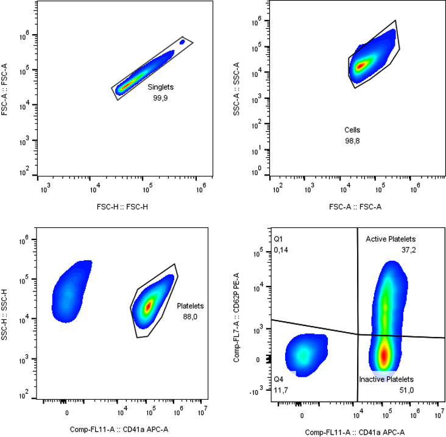
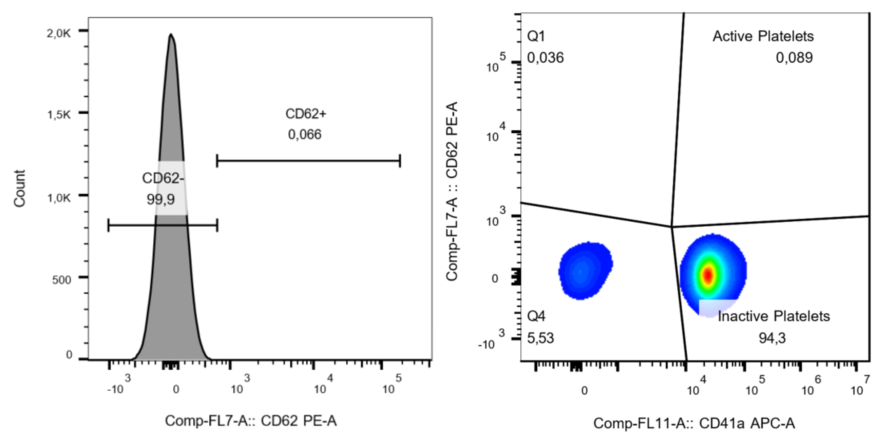
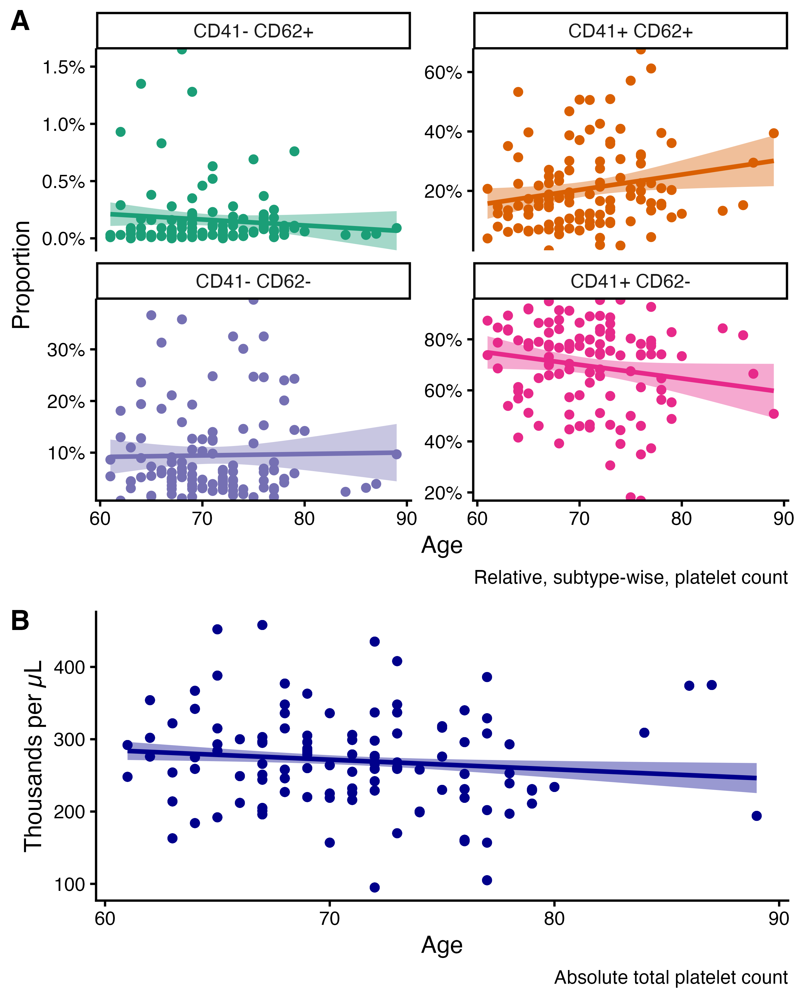
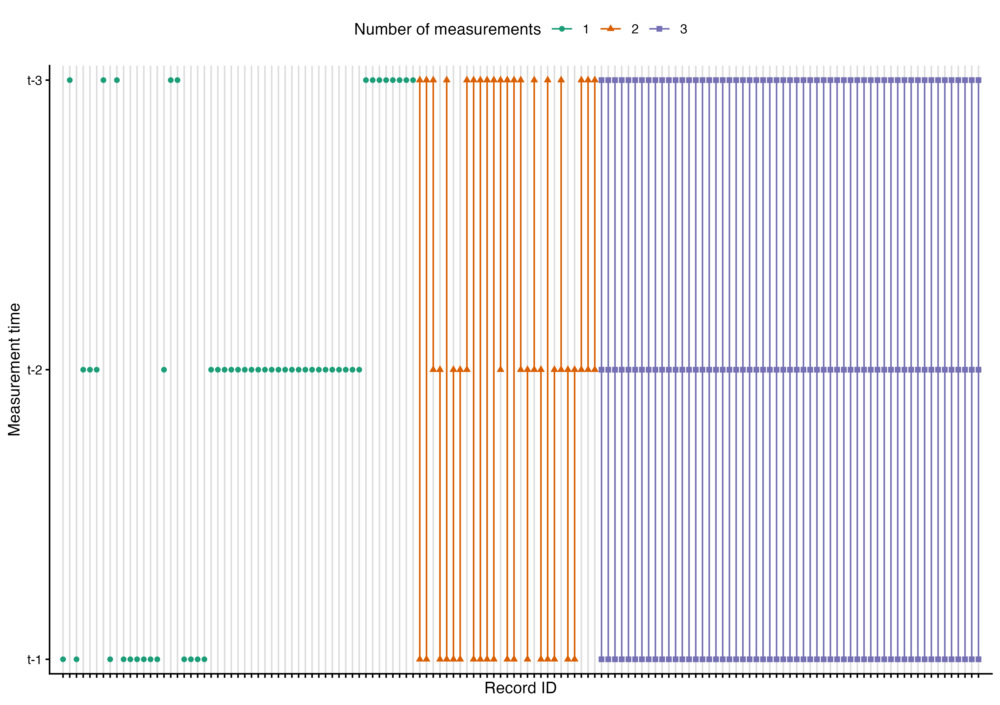
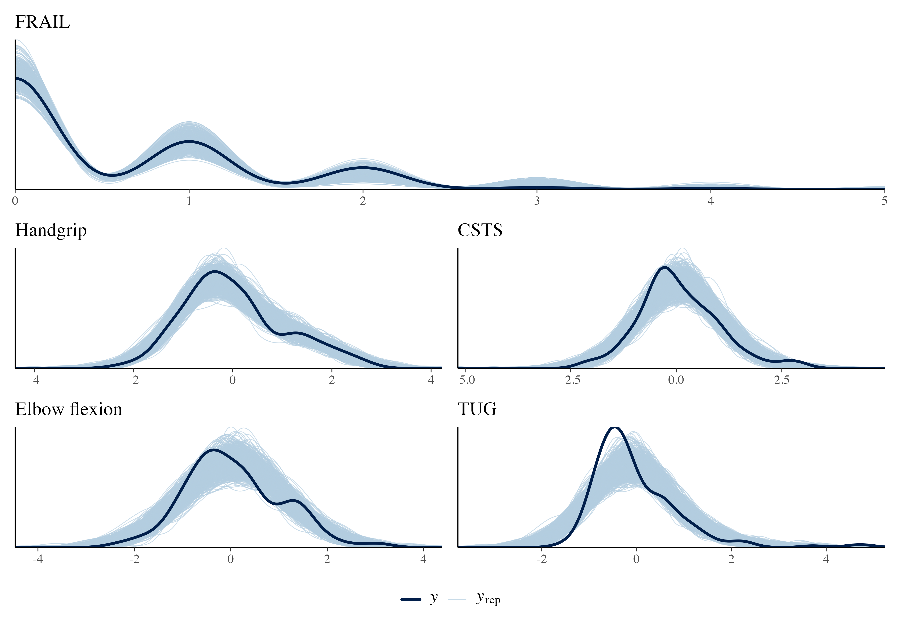
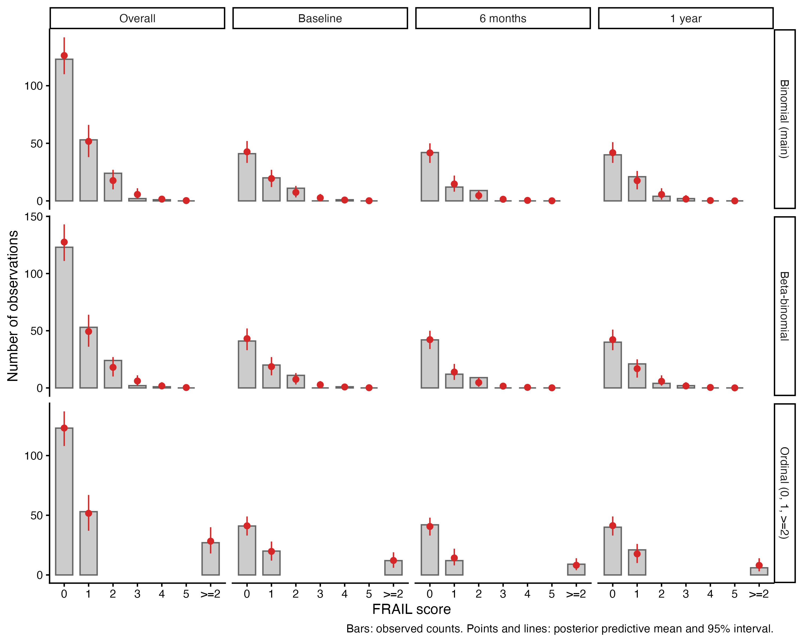
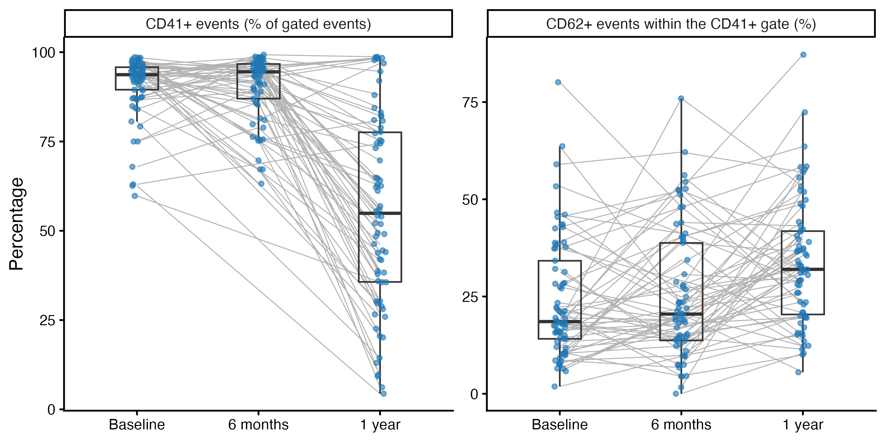
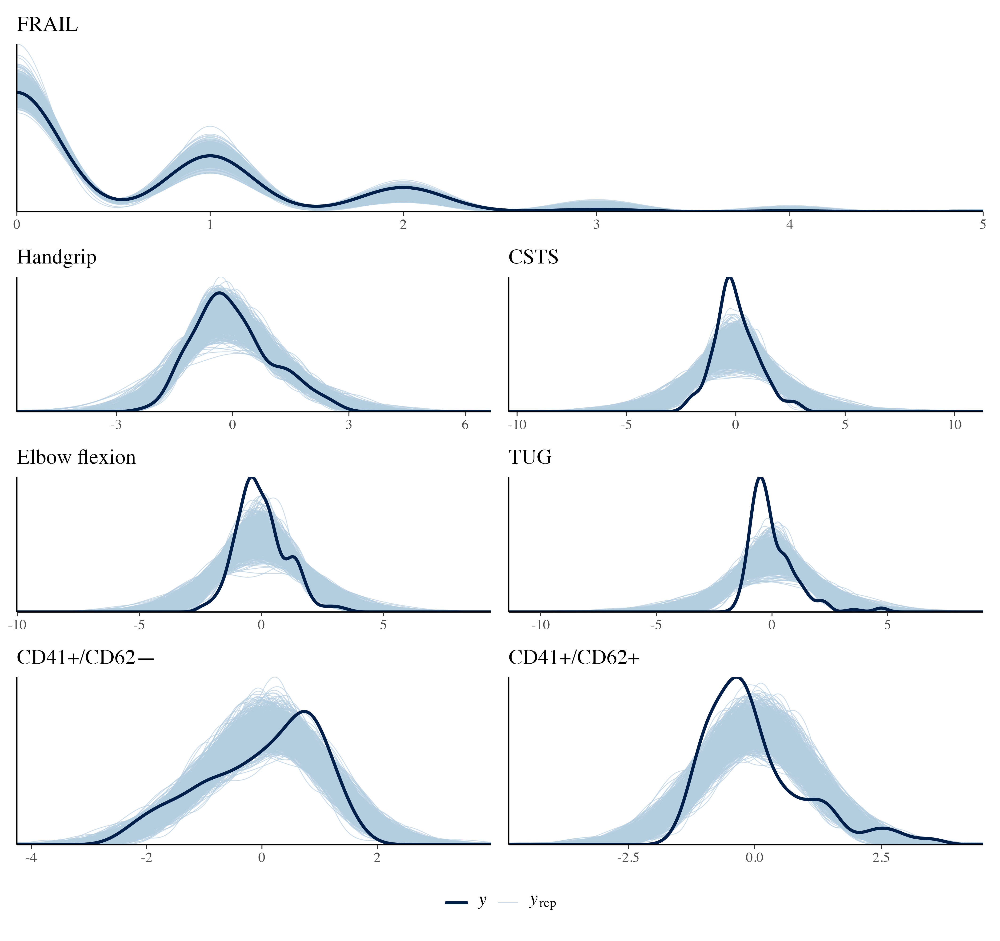
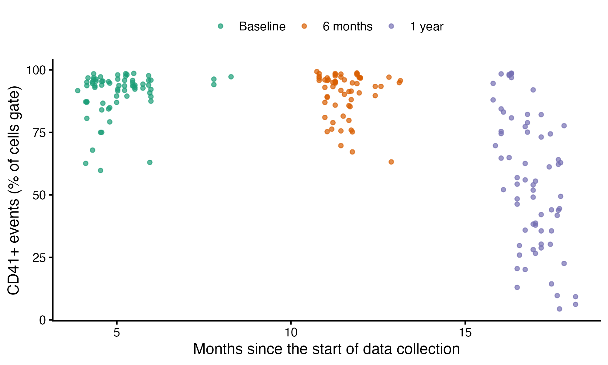

---
# Supplementary material (revised version, response to the second-round peer review).
# Render with:  quarto render manuscript/supplementary.qmd
format:
  docx:
    reference-doc: assets/reference-supplementary.docx
    keep-md: false
execute:
  echo: false
  warning: false
  message: false
---

```{r}
#| label: setup
source("_setup.R")
library(data.table)

# Table S1-S3 helper: parameter table -> flextable
param_flextable <- function(tab, widths) {
  flextable(tab) |>
    style_table(widths = widths / 1440,
                align = c("left", "left", "right", "center", rep("right", 5)))
}
# Generic flextable for the sensitivity tables (character columns)
sens_flextable <- function(tab, widths, size = 7, align = NULL) {
  flextable(tab) |>
    style_table(widths = widths, align = align %||% c("left", rep("left", ncol(tab) - 1)), size = size)
}
# Table S4: format as in the submitted version (7 significant digits per column)
fmt7 <- function(x) format(x, digits = 7)
```

**Supplementary Material: Longitudinal associations of platelet activation phenotypes with frailty and physical performance in older adults living at high southern latitudes**

Atenea Uribe-Ojeda^1^, Matías Castillo-Aguilar^1^, Ruby Méndez Muñoz^1^, Diego Mabe-Castro^1^, Antonia Cornejo Soto^1^, Pedro Delgado-Floody^2^, Pablo Valdés-Badilla^3,4^, Jordan Hernandez-Martinez^5,6^, Cristian Núñez-Espinosa^1,7^\*

^1^ Escuela de Medicina, Universidad de Magallanes, Punta Arenas, Chile

^2^ Department of Physical Education, Sport and Recreation, Universidad de La Frontera, Temuco 4811230, Chile. pedro.delgado@ufrontera.cl

^3^ Department of Physical Activity Sciences, Faculty of Education Sciences, Universidad Católica del Maule, Talca 3460000, Chile. valdesbadilla@gmail.com

^4^ Sports Coach Career, Faculty of Life Sciences, Universidad Viña del Mar, Viña del Mar 2520000, Chile

^5^ Department of Physical Activity Sciences, Universidad de Los Lagos, Osorno 5290000, Chile

^6^ Departamento de Educación, Facultad de Humanidades, Universidad de la Serena, La Serena 1700000, Chile

^7^ Red Interuniversitaria de Envejecimiento Saludable de Latinoamérica y Caribe (RIES-LAC)

**\* Corresponding author**

Cristian Núñez-Espinosa, Escuela de Medicina, Universidad de Magallanes, Punta Arenas, Chile. Centro Asistencial de Docencia e Investigación CADI-UMAG, Chile. e-mail: cristian.nunez@umag.cl. Address: Avenida Bulnes 01855, Box 113-D. Phone: +56 61 13 2201411.

{width=6.39in}

**Figure S1. Representative gating for platelet phenotypes.** Gating strategy used to identify platelets and their distribution according to CD41 and CD62 expression. Gates were sequentially applied to singlets, cells, and active and inactive platelets. A minimum of 50,000 total events were acquired per sample, of which 40,000 corresponded to CD41+ cells. The upper-right quadrant corresponds to CD41+ CD62+ cells.

{width=6.5in}

**Figure S2. Representative FMO control for platelet phenotypes.** The CD62-positive population was selected based on the parameters and gating strategy established using the fluorescence-minus-one (FMO) control.

{width=6.5in}

**Figure S3. Relationship between platelet subtypes, absolute platelet counts and chronological age.** A, Dispersion plot between platelet proportions according to CD41 and CD62 expression and chronological age of the subjects. B, Dispersion plot between absolute platelet counts and chronological age of the subjects. The line displayed in each plot corresponds to the best fit according to ordinary least squares regression. Finally, the empirical, non-parametric, bivariate correlation (Spearman’s method) for the upper panel (A) between age and platelets are the following for CD41-CD62+, `r rho_p("CD41- CD62+")`; CD41+CD62+, `r rho_p("CD41+ CD62+")`; CD41-CD62-, `r rho_p("CD41- CD62-")`; CD41+CD62-, `r rho_p("CD41+ CD62-")`. Moreover, for absolute platelet counts the correlation with age was `r rho_p("Total")`.

{width=6.5in}

**Figure S4. Patient-level measurement plot**.Lollipop plot showcasing the individual level measurement across stages. The complete record of subjects spans 137 participants. Assessments per timestamp: baseline, n = 88; 6-months, n = 101; 1-year, n = 89; Unique assessments: one, n = 53, two, n = 27 and three, n = 57, of whom 42 were male and 95 were female.

{width=6.5in}

**Figure S5.** **Posterior predictive check for the fitted main models**. The solid line represents the observed data (y), while the lighter lines represent simulated datasets (y~rep~) drawn from the posterior predictive distribution for the FRAIL score and for each physical-function outcome.

{width=6.5in}

**Figure S6. Discrete posterior predictive checks of the FRAIL models.** Observed number of visits at each FRAIL score (bars) and posterior predictive mean with 95% interval (points and lines), overall and by visit, for the main binomial model, a beta-binomial model, and a cumulative-logit model for the FRAIL score collapsed to 0, 1 and ≥2. Scores of 3, 4 and 5 were observed in 2, 1 and 0 of the 203 visits analysed by the main models, respectively.

{width=6.5in}

**Figure S7. Gate composition by visit.** Left: percentage of CD41-positive events among all events of the cells gate. Right: percentage of CD62-positive events within the CD41-positive gate. Grey lines join the samples of the same participant; boxes show the median and interquartile range. Source data: Supplementary Table S11.

{width=6.5in}

**Figure S8. Posterior predictive check for the models that estimate missing platelet values within the model (sensitivity analysis).** The solid line represents the observed data (y), while the lighter lines represent simulated datasets (y~rep~) drawn from the posterior predictive distribution for each model and submodel.

{width=6.5in}

**Figure S9. Percentage of CD41-positive events by date of assessment.** Each point is a sample (percentage of CD41-positive events among all events of the cells gate), coloured by visit. The date of assessment is the only available proxy of the assay batch. Within the 1-year visit the percentage decreased with the date of acquisition (Table S11b).

**1. Model parameters and convergence diagnostics**

In this section we present the complete list of model parameter coefficients and convergence diagnostics of the main models for each dependent and independent variable in Table S1. Models that estimate missing platelet values within the model, which include the total number of platelets as an independent variable (Table S2) or use the log-ratio of the CD41⁺ phenotypes (Table S3), are sensitivity analyses. The other sensitivity analyses (participant and observation counts, additional confounders, alternative FRAIL models, conventional mixed models, a log-ratio analysis in complete cases, and the gate composition by visit) are presented in section 4 (Tables S7–S12).

***Table S1**. Model parameters from the main adjusted multivariate models, fitted to the visits with observed outcomes, covariates, and platelet percentages (frailty: 203 visits from 97 participants; physical function: 186 visits from 95 participants). Estimates and 95% credible intervals (CI) correspond to the median and 95% highest density interval of the posterior distribution of model parameters. Parameter estimates are on standardized scales for both dependent and independent variables. Convergence and diagnostics of posterior distributions are presented as effective sample size (ESS) and potential scale reduction factor (R-hat) for each parameter estimate. BMI, body mass index.*

```{r}
#| label: table-s1
parameter_table_observed(c("main_frail", "main_function")) |>
  param_flextable(widths = c(1440, 2850, 1005, 975, 630, 555, 675, 750, 495))
```

***Table S2**. Sensitivity analysis (missing platelet values estimated within the model). Model parameters from adjusted multivariate models considering the inclusion of total platelets as a covariate in independent variables. Estimates and 95% credible intervals (CI) correspond to the median and 95% highest density interval of the posterior distribution of model parameters. Parameter estimates are on standardized scales for both dependent and independent variables. Convergence and diagnostics of posterior distributions are presented as effective sample size (ESS) and potential scale reduction factor (R-hat) for each parameter estimate. BMI, body mass index.*

```{r}
#| label: table-s2
parameter_table_mi(c("mi_frail_platelets", "mi_function_platelets")) |>
  param_flextable(widths = c(1995, 2640, 750, 885, 570, 540, 645, 765, 585))
```

***Table S3**. Sensitivity analysis (missing platelet values estimated within the model). Model parameters from adjusted multivariate models considering the use of the log of the ratio (ILR) between CD41^+^CD62^+^ to CD41^+^CD62^–^ platelets instead of the separated subtype proportions, (frailty and physical-function models, with the same adjustment as the other models). The ILR physical-function model is not considered within the inferential support due to poor parameter convergence diagnostics (effective sample sizes as low as 7.8 and R-hat up to 1.06 for the ILR terms) and is only shown for reference; a well-sampled complete-case version of the log-ratio analysis is presented in Table S10. Where the highest-density region of the posterior was not a single interval, the limits of the outermost interval are shown. Estimates and 95% credible intervals (CI) correspond to the median and 95% highest density interval of the posterior distribution of model parameters. Parameter estimates are on standardized scales for both dependent and independent variables. Convergence and diagnostics of posterior distributions are presented as effective sample size (ESS) and potential scale reduction factor (R-hat) for each parameter estimate. BMI, body mass index. ILR parameter is computed as (1/√2)\*log(CD41+CD62+ / CD41+CD62–).*

```{r}
#| label: table-s3
# Only the models reported in the manuscript
parameter_table_mi(c("mi_frail_logratio", "mi_function_logratio")) |>
  param_flextable(widths = c(2281, 3400, 934, 870, 555, 570, 690, 630, 495) / 10425 * 9360)
```

***Table S4**. Empirical bootstrap contrasts assessing the temporal trajectories of relative platelet subtypes in raw scales. Estimate, standard errors (SE) and 95% confidence intervals (CI) correspond to the mean and 95% quantile interval. The change in CD41⁺/CD62⁻ percentage between baseline and 1 year coincides with a change of similar magnitude in the percentage of CD41-positive events (Table S11).*

```{r}
#| label: table-s4
# Bootstrap contrasts (R/01-data/05-platelet-change-bootstrap.R; seed 1234)
tab <- fread(table_file("gate/s4-platelet-changes.csv"))
tab[, (3:7) := lapply(.SD, fmt7), .SDcols = 3:7]
flextable(tab) |>
  style_table(widths = c(1725, 1710, 855, 1245, 1500, 1500, 1650) / 10185 * 6.5,
              align = c("left", "left", rep("right", 5)), size = 8)
```

***Table S5**. Number of non-missing observations per variable at each assessment. Paired CD41/CD62 platelet data from baseline to the 1-year follow-up were available for 51 participants, and complete platelet data at all three assessments for 41 participants. Reasons for non-attendance were not recorded.*

```{r}
#| label: table-s5
# Number of non-missing observations per variable and timestamp
fread(table_file("descriptives/s5-observations.csv")) |>
  flextable() |>
  style_table(widths = rep(9355 / 4 / 1440, 4), align = c("left", rep("right", 3)), size = 10)
```

**Table S6.** **Model level diagnostics for the main models**: maximum R-hat, minimum bulk and tail effective sample size over all parameters, divergent transitions, iterations that hit the maximum treedepth (12), E-BFMI per chain, and the observations and participants used. These were computed using the rstan R package and the functions rstan::check_hmc_diagnostics(), rstan::get_num_max_treedepth(), rstan::get_bfmi() and rstan::get_num_divergent() on the fitted models.

```{r}
#| label: table-s6
fread(table_file("diagnostics/s6-s10b-diagnostics.csv"))[1:2] |>
  sens_flextable(widths = c(1.4, 0.5, 0.55, 0.55, 0.65, 0.65, 0.9, 0.4, 0.5), size = 6.5)
```

**2. Missing values and uncertainty propagation (sensitivity analysis)**

The main models use the visits with observed platelet percentages. This section describes the sensitivity analysis in which missing platelet predictors are estimated within the model; its results are reported in Tables S2, S3, S8, S9 and S12 and Figure S8.

To fully utilize the available longitudinal data and avoid the known biases associated with complete-case analysis (listwise deletion), missing values in the primary platelet composition predictors were handled directly within the Bayesian estimation framework. The analytical pipeline utilizes a fully Bayesian joint modeling approach to address missingness in the standardized percentages of CD41+/CD62- and CD41+/CD62+ platelets.

Rather than relying on external multiple imputation procedures prior to analysis, the missing predictor values are treated as unknown parameters and estimated simultaneously with the main outcome models (frailty, body composition, and physical function). This is implemented using the mi() function within the brms package, which dynamically specifies a multivariate model architecture linking the primary outcome equations with auxiliary sub-models for the incomplete predictors.

**2.1. Mathematical Specification of the Imputation Sub-Models**

Let $P_{it}^{}$ generically denote one of the standardized platelet subtype predictors (either $P_{it}^{-}\ $ or $P_{it}^{+}$) for participant $i$ at measurement occasion $t$. The observed data vector can be partitioned into observed components, $P_{obs}^{}$, and missing components, $P_{mis}^{}$. To estimate the joint posterior distribution, the missing data mechanism requires an explicit probabilistic model for $P_{it}^{}$.

Auxiliary Gaussian sub-models are constructed for both $P_{it}^{-}\ $ and $P_{it}^{+}$. These sub-models are defined to depend on the categorical time factor and a participant-specific random intercept. The structural equation for each missing predictor is formulated as $P_{it} \sim N\left( \mu^{P_{it}},\sigma_{P}^{2} \right)$, where the linear predictor for the auxiliary model is strictly defined as $\mu^{P_{it}} = \gamma_{0} + \gamma_{1}Time_{t} + v_{i}$. In this formulation, $\gamma_{0}$ represents the intercept, $\gamma_{1}$ denotes the fixed effect of the measurement occasion, and $v_{i} \sim N\left( 0,\sigma_{}^{2} \right)$ is the random intercept for participant $i$. The inclusion of the random intercept ensures that the imputation respects the within-person correlation structure of the repeated measurements across time. Consequently, information from a participant's observed platelet measurements at other time points is explicitly leveraged to inform the estimation of their missing values at a given time point. No other imputation sub-models were considered, so a missing value in other covariates or outcome variables were handled by case-wise deletion for each model.

**2.2. Propagation of Uncertainty**

By embedding the imputation process directly within the Bayesian model fitting step, the algorithm targets the joint posterior distribution of both the main model parameters (denoted collectively as $\Theta$) and the missing data values $P_{mis}^{}$. The joint posterior is proportional to the product of the likelihood of the primary outcomes conditionally on the predictors, the likelihood of the auxiliary predictor models, and the prior distributions.

Because Hamiltonian Monte Carlo (HMC) estimation algorithms evaluate this joint density at each iteration, a new set of plausible values for $P_{mis}^{}$ is drawn based on the current state of $\Theta$ and the auxiliary parameters. The main models specify normal prior distributions, normal priors for standard deviations, and HMC sampling is conducted utilizing 4 chains with 10,000 iterations (5,000 for warmup).

This joint parameterization ensures uncertainty propagation. Specifically, the uncertainty regarding the true value of $P_{mis}^{}$ is continuously mapped into the estimation of the regression coefficients linking platelet composition to frailty, body composition, and physical function. Moreover, the resulting posterior credible intervals for the main effects, time interactions, and residual correlations automatically widen to reflect the loss of information due to missingness. Additionally, it inherently prevents the artificial overconfidence in parameter estimates that commonly plagues single-imputation strategies.

Through this structure, the final posterior summaries accurately represent both the natural biological variability of the outcomes and the epistemological uncertainty introduced by the incomplete observation of the longitudinal platelet markers.

**3. Model algorithm and settings**

All Bayesian multilevel regression models were estimated using the brms package (version 2.21.0) in R, which interfaces with the Stan probabilistic programming language. Posterior distributions were sampled using HMC estimation. For every model in the analytical pipeline, HMC sampling was conducted using 4 parallel chains distributed across 4 computational cores. Each chain was run for 10,000 total iterations, with the initial 5,000 iterations designated as the warmup phase and subsequently discarded, yielding a total of 20,000 post-warmup samples for posterior inference. A fixed random seed of 1234 was applied uniformly across all model fits to guarantee computational reproducibility.

Given the mathematical complexity of the multivariate joint formulations and the simultaneous missing data imputation structures, the sampler's control parameters were strictly adjusted to ensure optimal exploration of the posterior geometry. Specifically, the target average proposal acceptance probability (adapt_delta) was elevated to 0.999 to minimize the risk of divergent transitions. Additionally, the maximum tree depth (max_treedepth) was increased to 50 to prevent premature trajectory termination during sampling. Convergence was assessed and confirmed using standard HMC diagnostics and effective sample size evaluations via the rstan framework.

To mitigate over-parameterization and regularize the estimates, weakly informative prior distributions were applied. For the primary frailty models and the auxiliary missing data sub-models, the fixed-effect regression coefficients (class b) were assigned $N(0,1.5)$ priors. The variance parameters, including the standard deviations for the participant-level random intercepts (class sd) and the residual standard deviations for the Gaussian imputation models (class sigma), were assigned $N(1,1.5)$ priors with a strict lower bound of 0 (truncated-normal distributions). The body composition and physical function models utilized the same priors for their multivariate Gaussian structures while explicitly estimating the residual correlation matrices among the joint outcomes using the set_rescor(TRUE) directive.

The main models and the other models fitted to observed data (complete cases; section 4) were sampled with 4 chains of 6,000 iterations (3,000 warmup), adapt_delta = 0.99 and max_treedepth = 12, with the same seed (1234). The priors were N(0, 1.5) for regression coefficients (class b), N(1, 1.5) truncated at 0 for the standard deviations of the participant random intercepts and of the residuals, N(0, 2.5) for the intercept of the binomial frailty models, and LKJ(2) for the residual correlations of the physical-function models.

**4. Sensitivity analyses**

This section collects the sensitivity analyses. All models use the same standardization of outcomes and predictors as the main models. The main models and the alternative models of this section use complete cases (the visits in which the outcome(s), the covariates sex, age and BMI, and both platelet percentages were observed). The models that estimate missing platelet values within the model (section 2) are labelled "imputation-based". The diagnostics of the models are shown in Table S6 (main models) and Table S10b.

***Table S7**. Participants and visit-level observations entering each model family. "Outcome and covariates available" counts correspond to the rows in which the outcome and sex, age and BMI were available, which contribute to the outcome likelihood of the imputation-based models; "observed platelets" counts are the rows in which both platelet percentages were also observed, which are the rows used by the main models. The last column gives the visits (baseline / 6 months / 1 year) with observed platelets. Missing outcomes and covariates are not imputed in any model.*

```{r}
#| label: table-s7
fread(table_file("descriptives/s7-models.csv")) |>
  sens_flextable(widths = c(0.8, 1.2, 0.65, 0.65, 0.7, 0.7, 0.8), size = 7)
```

***Table S7b**. Participants with platelet data, visits with platelet data and paired platelet data.*

```{r}
#| label: table-s7b
fread(table_file("descriptives/s7-paired.csv"))[, list(Quantity, N = as.character(N))] |>
  sens_flextable(widths = c(5, 1.5), size = 8)
```

***Table S7c**. Completeness of the additional confounders (diabetes and statin use). Diabetes is a participant-level attribute; statin use changed between visits in 27 participants.*

```{r}
#| label: table-s7c
fread(table_file("descriptives/s7-confounders.csv")) |>
  sens_flextable(widths = c(1.2, 1.4, 2.2, 1.7), size = 8)
```

***Table S8**. Frailty: platelet coefficients (log-odds scale; for the cumulative-logit model, log-odds of a higher category) in the main model and in the sensitivity analyses. Posterior median and 95% HDI. The beta-binomial and ordinal models use the same predictors and priors as the main model, and "+ diabetes, statins" adds both variables as main effects. The imputation-based models estimate missing platelet values within the model; "participants with platelet data" restricts them to the 97 participants with at least one platelet measurement.*

```{r}
#| label: table-s8
fread(table_file("models/s8-frailty.csv"), na.strings = "") |>
  sens_flextable(widths = c(0.5, 0.85, 0.8, 0.8, 0.8, 0.8, 0.8, 0.9), size = 6)
```

***Table S8b**. Frailty: odds ratio (95% credible interval) of a higher FRAIL score per 1 SD higher percentage of each platelet phenotype (main effects; pooled over time).*

```{r}
#| label: table-s8b
fread(table_file("models/s8b-odds-ratios.csv")) |>
  sens_flextable(widths = c(2, 1.5, 2), size = 8)
```

***Table S9**. Physical function: platelet coefficients in the main model and in the sensitivity analyses (standardized units; posterior median and 95% HDI).*

```{r}
#| label: table-s9
fread(table_file("models/s9-function.csv"), na.strings = "") |>
  sens_flextable(widths = c(0.7, 0.9, 0.9, 0.9, 0.9, 1.0, 0.9), size = 6)
```

***Table S9b**. Physical function: difference in each outcome, in original units, associated with a 1 SD higher percentage of each platelet phenotype (main effects; posterior median and 95% HDI), obtained by multiplying the standardized coefficient by the SD of the outcome. The SDs of the platelet percentages (percentage points) are given for reference.*

```{r}
#| label: table-s9b
fread(table_file("models/s9b-original-units.csv")) |>
  sens_flextable(widths = c(1.1, 1.1, 0.6, 0.9, 0.8, 1.9), size = 6.5)
```

***Table S9c**. Physical function: platelet coefficients (standardized units; estimate and 95% Wald confidence interval) from conventional linear mixed models without imputation (random intercept per participant; time by platelet percentages, sex, age and BMI), fitted to the visits with observed outcome, covariates and platelet percentages.*

```{r}
#| label: table-s9c
fread(table_file("models/s9c-mixed-models.csv")) |>
  sens_flextable(widths = c(1.4, 1.0, 0.7, 0.9, 1.6), size = 8)
```

***Table S10**. Log-ratio analysis in complete cases. Coefficients of the standardized log-ratio ln(CD41⁺/CD62⁺ events / CD41⁺/CD62⁻ events) (the isometric log-ratio coordinate for two parts is this value divided by √2; the standardization makes the constant immaterial). Posterior median and 95% HDI. Unlike the imputation-based log-ratio models of Table S3, these models were adequately sampled (Table S10b).*

```{r}
#| label: table-s10
fread(table_file("models/s10-logratio.csv"), na.strings = "") |>
  sens_flextable(widths = c(1.0, 1.3, 2.0, 2.2), size = 7)
```

***Table S10b**. Sampling diagnostics of the sensitivity models (maximum R-hat, minimum bulk and tail effective sample size, divergent transitions, iterations that hit the maximum treedepth, E-BFMI per chain, observations and participants). "Across visits" refers to the Gaussian mixed models of each platelet percentage used for Figure 2.*

```{r}
#| label: table-s10b
fread(table_file("diagnostics/s6-s10b-diagnostics.csv"))[-(1:2)] |>
  sens_flextable(widths = c(1.4, 0.5, 0.55, 0.55, 0.65, 0.65, 0.9, 0.4, 0.5), size = 6)
```

***Table S11**. Gate composition by visit: median [interquartile range] of the percentages of events in each quadrant (percentage of all events in the cells gate), of CD41-positive events and of CD62-positive events within the CD41-positive gate, and paired within-participant changes (mean difference and 95% bootstrap interval, 10,000 resamples) in participants with data at both visits. Samples with a low share of CD41-positive events by visit are given below the table.*

```{r}
#| label: table-s11
fread(table_file("gate/s11-by-visit.csv")) |>
  sens_flextable(widths = c(1.4, 0.8, 0.8, 0.8, 1.0, 1.0), size = 6.5)
```

```{r}
#| label: table-s11b
fread(table_file("gate/s11-low-cd41.csv")) |>
  sens_flextable(widths = c(1.2, 1.6, 1.6, 0.6), size = 7.5)
```

***Table S11b**. Assessment dates and gate summaries by visit: period and median date of the assessments (dates are those recorded in the study database; one baseline date preceding the start of the study was treated as a data-entry error), percentage of singlets among all events, percentage of cells among singlets, percentage of CD41-positive events among the cells gate (median [interquartile range]), and Spearman correlation between the percentage of CD41-positive events and the date of assessment within each visit.*

```{r}
#| label: table-s11c
tt <- fread(table_file("gate/s11-dates.csv"))
tt <- data.table(Characteristic = names(tt)[-1], t(as.matrix(tt[, -1])))
setnames(tt, c("Characteristic", fread(table_file("gate/s11-dates.csv"))$Visit))
sens_flextable(tt, widths = c(2.4, 1.3, 1.3, 1.3), size = 7.5)
```

***Table S11c**. Percentage of CD41-positive events by month of assessment (median [interquartile range]).*

```{r}
#| label: table-s11d
fread(table_file("gate/s11-months.csv")) |>
  sens_flextable(widths = c(1.2, 1.2, 0.9, 2.8), size = 7.5)
```

**4.1. Models that estimate missing platelet values within the model**

The imputation-based models (section 2) gave platelet coefficients for physical function that are larger than those of the main models (Table S9; parameters in Table S12): for chair sit-to-stand, for example, the CD41⁺/CD62⁻ coefficient was `r sens_cell("s9", "Chair sit-to-stand", "CD41+CD62-", "Imputation-based")` in the imputation-based model and `r sens_cell("s9", "Chair sit-to-stand", "CD41+CD62-", "Main (complete cases)")` in the main model. The imputation-based estimates were unchanged when the analysis was restricted to the 97 participants with at least one platelet measurement or when diabetes and statin use were added, and they were obtained with low effective sample sizes (minimum bulk ESS 341 to 406 in these models, Table S10b). They arise in the visits in which the platelet values are estimated within the model (62 of 248 visits in the imputation-based physical-function model, and 17 of 203 in the model restricted to participants with platelet data), and they are not reproduced when only observed platelet-outcome pairs are used (main models and conventional mixed models, Table S9c). The coefficients are large (about one standard deviation of the outcome per standard deviation of the platelet percentage), which is compatible with the outcome informing the platelet values that are estimated within the model. We therefore consider these estimates less reliable than those of the main models. For frailty, the imputation-based and main models gave the same estimates (Table S8).

***Table S12**. Model parameters from the imputation-based adjusted multivariate models (missing platelet values estimated within the model; frailty: 268 visits from 136 participants; physical function: 248 visits from 135 participants). Estimates and 95% credible intervals (CI) correspond to the median and 95% highest density interval of the posterior distribution of model parameters. Parameter estimates are on standardized scales for both dependent and independent variables. ESS, effective sample size; R-hat, potential scale reduction factor.*

```{r}
#| label: table-s12
parameter_table_mi(c("mi_frail", "mi_function")) |>
  param_flextable(widths = c(1440, 2850, 1005, 975, 630, 555, 675, 750, 495))
```
